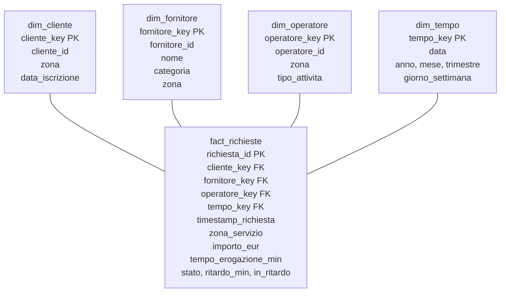

# Modello dimensionale: schema a stella

**Grana del fatto:** una riga corrisponde a una richiesta di servizio, identificata da `richiesta_id`.

Ciascuna delle quattro dimensioni ha una relazione **1 a molti** con la tabella centrale: un cliente, un fornitore, un operatore o una data possono essere associati a più richieste; ciascuna richiesta punta a una sola riga di ognuna delle quattro dimensioni.

## Perché uno schema a stella?

Semplifica le interrogazioni analitiche, separa le misure quantitative (`importo_eur`, `tempo_erogazione_min`) dagli attributi descrittivi (cliente, fornitore, operatore, tempo) ed evita di ripetere tutte le informazioni di questi soggetti in ogni richiesta. Per una dimostrazione con SQLite e poche centinaia di record è leggibile e sufficiente.

**Distinzione importante:** le colonne `cliente_id`, `fornitore_id`, `operatore_id` rappresentano identificativi fittizi generati dal programma e non permettono di identificare persone reali.
